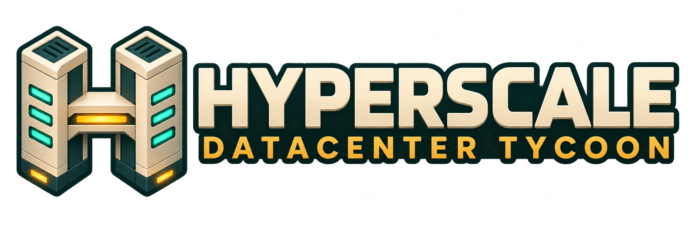

<p align="center"></p>

# Hyperscale: Datacenter Tycoon

A native Windows construction and management game built with **Godot 4.5.1**.
Turn an old warehouse into an AI datacenter campus, win customer contracts, keep
power and cooling running through heatwaves and grid faults, and negotiate with a
town that has its own opinions about your expansion.

| | |
| --- | --- |
| Standalone demo | **1.2.0**: three towns, research, staff, guided intro, achievements and fictional companies (`Play.cmd`) |
| Previous preview | **1.2.0-preview.2** remains available through `Play Preview.cmd`; save and close one build before opening another |
| Platform | Windows x64, offline, single player, no account or AI service required |
| Status | Phases 1–13 implemented and locally verified. Standalone demo and Steam materials ready; not yet on Steam. |


## Play

Double-click **`Play.cmd`** for the 1.2.0 standalone demo. In the portable ZIP, run
**`Hyperscale Datacenter Tycoon.exe`** after extraction. The executables in `build/` are standalone (the game data is embedded),
so you don't need to install Godot. Save and close any running older build before opening a newer one.

From the title screen choose **New Company**, name it, pick a town (or sandbox) and
a difficulty. Towns open paused, so press **Space** to start time. **F1** opens the
in-game guide.

**First steps:** buy warehouse 04-06 ($1,200), clear it ($250) and build a server hall.
Buy the neighbouring plots 03-06 and 04-07 for a substation and a cooling plant. Run
time to earn your first revenue, then sign GPN or Synthopic from **Contracts (C)**.

## What's in the game

- **Build:** a 16×16 town with districts, a river, homes, parks and landmarks. Buy, clear
  and build halls, substations and cooling plants across three equipment tiers,
  with utility reach, road access and itemized costs.
- **Customers and finance:** up to three concurrent contracts for inference, training, critical
  and experimental workloads. Hardware profiles, a spot market, loans and a fully
  reconciled ledger.
- **Operations:** forecast heatwaves and grid work, surprise faults, equipment wear.
  Batteries, generators, fuel, mobile cooling and maintenance crews.
- **Civic pressure:** per-district approval, noise, traffic, displacement and heritage
  concerns that escalate from warnings and petitions to protests and permit pauses.
  You respond through town-council remedies.
- **Three towns**: Littlebrook, hot and water-limited Sunsprawl, and historic
  Oldbridge, each with its own charter and optional distinctions.
- **Research and staff**: compute-funded Engineer, Commercial and Visionary
  projects, plus technician, engineer and commercial teams with visible dispatches.
- **Presentation:** original code-drawn isometric art (50-sprite atlas), animated
  citizens and traffic, synthesized adaptive music and ambience, a guided introduction,
  local achievements, remappable controls, text scaling and reduced motion.

The full rules, costs and controls are in **[docs/GAME-GUIDE.md](docs/GAME-GUIDE.md)**.

### Controls

| Key | Action | Key | Action |
| --- | --- | --- | --- |
| Q / B / X | Inspect / buy / bulldoze | Space / F4 | Pause / cycle speed |
| 1 / 2 / 3 | Hall / substation / cooling | F5 / F9 | Quicksave / load |
| C / G | Contracts / company | F1 or ? | Game guide |
| Wheel / middle-drag / Home | Zoom / pan / whole town | F11 or Alt+Enter | Fullscreen |
| Escape | Close panel / pause menu | R | One-time rescue grant (cash < $2,000) |

## Saves

Saves live in **`%APPDATA%\Datacenter Tycoons\`**. That folder name is kept from earlier
project names so old towns still load. It holds named slots, a quicksave, scenario
checkpoints and three rotating autosaves, each with a thumbnail and a `.bak` of the
previous good save. The current save schema is **12**, and versions 1–11 migrate
automatically. QA runs (`--qa`) use separate slots and settings.

## Project layout

```
project.godot, main.tscn   Godot project and root scene (scripts/main.gd)
export_presets.cfg         "Windows Desktop" export, embedded pack, excludes tests/.tools/build
scripts/                   All game code (GDScript)
assets/                    Baked town atlas (png + json) and synthesized audio (wav)
tests/                     Headless test suites, playthroughs, render/bake utilities
dev/generate_audio.py      Reproducible generator for assets/audio/*.wav
docs/                      Game guide, phase plans, release audits, credits
release/steam/             Store-page copy, screenshots, Steamworks handoff notes
build/                     Exported executables, ZIPs, QA logs and renders (git-ignored)
.tools/                    Local Godot 4.5.1 binaries, export template, source checkpoints (git-ignored)
```

Key scripts:

| Area | Scripts |
| --- | --- |
| Core simulation, saves and validation | `simulation.gd`, `save_store.gd`, `game_settings.gd` |
| Economy and contracts | `economy.gd`, `clients.gd`, `business_board.gd`, `finance_panel.gd`, `client_panel.gd` |
| Operations and incidents | `operations.gd`, `operations_panel.gd` |
| Civic system | `civic.gd`, `town_panel.gd` |
| Towns, research, staff | `scenarios.gd`, `research.gd`, `workforce.gd` (+ `*_panel.gd`) |
| Guide and achievements | `tutorial.gd`, `achievements.gd` (+ `*_panel.gd`) |
| World rendering and map | `town_view.gd`, `town_ground.gd`, `town_art.gd`, `town_rules.gd`, `map_tools.gd`, `minimap.gd` |
| UI shell and audio | `main.gd`, `app_menu.gd`, `soundscape.gd` |

## Development

Open `project.godot` in Godot 4.5.1 (GL Compatibility renderer) and press F5. This
workspace includes a portable engine in `.tools/godot/`. Because `.tools/` is
git-ignored, a fresh checkout has to install
[Godot 4.5.1](https://github.com/godotengine/godot/releases/tag/4.5.1-stable) and its
export templates separately. Also update `custom_template/release` in `export_presets.cfg`, or
clear it so Godot uses its installed template.

The examples below use PowerShell and run from the project root.

```powershell
$godot = '.tools/godot/Godot_v4.5.1-stable_win64_console.exe'

# Run a test suite headlessly (--qa isolates saves/settings)
& $godot --headless --path . --script tests/test_simulation.gd -- --qa

# Export the standalone Windows build
& $godot --headless --path . --export-release 'Windows Desktop' 'build/Hyperscale Datacenter Tycoon.exe'

# After changing artwork in scripts/town_art.gd: rebake the atlas (needs a window), then reimport
& $godot --path . --script tests/bake_art.gd
& $godot --headless --path . --editor --import --quit

# Regenerate the synthesized audio
python dev/generate_audio.py
```

### Tests

Each `tests/test_*.gd` file is a `SceneTree` script that prints its check count and
exits non-zero on failure.

| Suite | Covers |
| --- | --- |
| `test_simulation`, `test_progression` | Construction, economy, campaign without injected cash, migration, mid-contract saves |
| `test_economy`, `test_balance` | Workloads, hardware, loans and ledger invariants, five full-campaign strategies |
| `test_operations`, `test_civic` | Incidents, reserves, wear, civic escalation and remedies, exact save continuation |
| `test_scenarios`, `test_research`, `test_workforce`, `test_clients` | Towns and charters, research, staff and dispatch, fictional companies |
| `test_tutorial`, `test_frontdoor`, `test_interface`, `test_geography`, `test_visual_review`, `test_presentation` | Guide, title/save flows, layout, map, art and audio state |
| `test_release` | Release soak (long session, large campus) |

The other scripts in `tests/` are utilities: `play_*.gd` playthroughs, `packaged_journey.gd`
and `fullscreen_probe.gd`, which run against the exported executable, `render_preview.gd`
and `capture_release.gd` for screenshots, and `operating_strategy.gd`, a shared helper.

## Documentation

- [docs/GAME-GUIDE.md](docs/GAME-GUIDE.md): full player rules and reference
- [docs/PHASES.md](docs/PHASES.md) / [docs/PHASES-7-13.md](docs/PHASES-7-13.md): delivery plan, evidence and design research
- [docs/RELEASE-1.2.md](docs/RELEASE-1.2.md): current requirement audit, 1,003 checks and performance limits
- [docs/RELEASE-1.1.md](docs/RELEASE-1.1.md) / [docs/REVIEW-1.1.1.md](docs/REVIEW-1.1.1.md): earlier audits
- [docs/FICTIONAL-COMPANIES.md](docs/FICTIONAL-COMPANIES.md): the nine customer companies
- [release/steam/](release/steam/): store-page draft and Steam integration handoff (no App ID yet)
- [docs/CREDITS.md](docs/CREDITS.md): credits and asset provenance
- [docs/QUICKSTART.md](docs/QUICKSTART.md): play, update, save recovery and logs

## License and credits

All town artwork is original and drawn in code. Music and ambience are synthesized by
`dev/generate_audio.py`, and the company names and stories are fictional. Godot Engine is MIT
licensed, and its license and third-party notices ship with the portable build. See
[docs/CREDITS.md](docs/CREDITS.md). The project itself does not yet declare a license.
